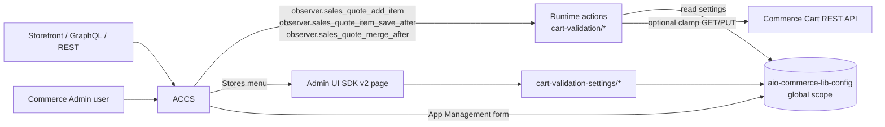

# Cart Item Validation (ACCS + App Builder + Admin UI SDK)

Adobe Commerce as a Cloud Service (ACCS) app that limits the quantity of each individual cart line to a merchant-configured maximum (default **10**). Built with Adobe App Builder, `@adobe/aio-commerce-sdk` (App Management), synchronous Commerce webhooks and Admin UI SDK v2.

**No Adobe Commerce PHP / module customization is required.**

> **Status:** implemented per CDA Technical Blueprint v7 ([Docs/CDA-blueprint-7.md](Docs/CDA-blueprint-7.md)). Local unit tests and type checks pass. **Not yet verified on a live ACCS sandbox** — see [Docs/verified-contracts.md](Docs/verified-contracts.md). Do not treat the app as operational or list it on Marketplace until that record contains live evidence.

---

## 1. Business rules

| Rule | Behaviour |
|---|---|
| Scope | Maximum applies **per cart line**, never to the cart total. SKU-A = 10 and SKU-B = 10 is allowed. |
| Limit | `quantity <= maxQuantity` → allow; `quantity > maxQuantity` → reject |
| Default | `maxQuantity = 10`, `enabled = true` |
| Enable / Disable | `enabled = false` bypasses validation; the saved maximum is kept |
| Removal | `qty = 0` is always allowed |
| Product lines | Parent and child lines are each evaluated (blueprint v2 "Parent + child lines") |
| Guest → customer merge | Merged cart is revalidated; any over-limit line rejects the merge |
| Scope of settings | Single global limit (all websites / stores) |
| Compensating correction | Optional (default on): if a save-after or merge-after hook finds an over-limit line, the app clamps it to `maxQuantity` through the Commerce Cart REST API |

Rejection message currently returned: `Maximum quantity for <SKU> is <max>.`

> ⚠ The original requirement (Docs/ACCS_App_Builder_Cart_Item_Max_Quantity_Implementation_Blueprint.md, BR-04) requires the exact message `You have reached the maximum amount of items.` — open item.

---

## 2. Architecture



| Component | Location | Purpose |
|---|---|---|
| `cart-validation/validate-cart-item` | `src/commerce-extensibility-1/actions/webhook/validate-cart-item/` | Add-item and item-save webhook handler (`index.js` + `validator.js` payload parsing) |
| `cart-validation/revalidate-quote-merge` | `src/commerce-extensibility-1/actions/webhook/revalidate-quote-merge/` | Merge webhook handler (`index.js` + `validator.js`) |
| Webhook package definition | `src/commerce-extensibility-1/actions/webhook/actions.config.yaml` | Included from `ext.config.yaml` via `$include` |
| Shared helpers | `src/commerce-extensibility-1/actions/lib/` | `settings.js` (config read), `is-over-limit.js` (rule), `commerce-api-client.js` (compensating clamp); `settings.js` and `is-over-limit.js` are also imported by the settings actions (same App Builder app) |
| Admin ACL check | `src/commerce-backend-ui-2/actions/lib/permissions.js` | Server-side menu ACL check for both settings actions |
| `cart-validation-settings/get-cart-validation-settings` | `src/commerce-backend-ui-2/actions/` | Returns settings to the Admin page |
| `cart-validation-settings/save-cart-validation-settings` | `src/commerce-backend-ui-2/actions/` | Validates and persists settings |
| Admin page | `src/commerce-backend-ui-2/web-src/` | React page under **Stores → Cart Item Validation** |
| App definition | `app.commerce.config.ts` | Metadata, business config schema, Admin menu, webhooks |
| Generated code | `src/**/.generated/` | Produced by `aio-commerce-lib-app` (App Management install/config actions, manifest, config schema); committed like Adobe's starter kit, never hand-edited |

---

## 3. ACCS webhooks

Declared in [app.commerce.config.ts](app.commerce.config.ts). **Subscribed automatically** by the generated `app-management/installation` action when the app is installed through App Management (and removed on uninstall). `aio app deploy` alone does not subscribe anything.

| Webhook method | Type | Hook name | Action | Required | Timeout / soft |
|---|---|---|---|---|---|
| `observer.sales_quote_add_item` | before | `validate_add_item` | `validate-cart-item` | yes | 5000 / 1000 ms |
| `observer.sales_quote_item_save_after` | before | `validate_saved_item` | `validate-cart-item` | yes | 5000 / 1000 ms |
| `observer.sales_quote_merge_after` | before | `validate_merged_quote` | `revalidate-quote-merge` | yes | 5000 / 1000 ms |

Batch: `cart_item_validation`. All entries use `requireAdobeAuth: true` (Commerce calls the action with the workspace OAuth credentials) and `fallback_error_message: "Unable to update the cart right now. Please try again."` (shown when the action fails or times out). No `fields` filter is set yet, so Commerce sends the full payload until the paths below are verified.

### Payload fields used (candidate — verify in sandbox)

| Hook | Path | Fields |
|---|---|---|
| add item | `data.quoteItem` | `sku`, `qty`, `item_id`, `quote_id`, `product_type` |
| item save | `data.item` | same as above |
| merge | `data.quote` | `entity_id`, `items[].{sku, qty, item_id, quote_id, product_type}` |

### Responses

Built with `@adobe/aio-commerce-lib-webhooks/responses`:

- Allow: `ok(successOperation())` → `{ "op": "success" }`
- Reject: `ok(exceptionOperation(message))` → `{ "op": "exception", "message": "…" }`

---

## 4. Prerequisites

- Node.js 22+ (Runtime actions use `nodejs:24`) and npm
- Adobe I/O CLI: `npm install -g @adobe/aio-cli`
- Access to an approved **ACCS sandbox** with **App Management** and **Admin UI SDK** enabled
- Adobe Developer Console project + workspace subscribed to:
  - I/O Management API
  - ACCS REST API (`ACCS-REST-API`)
  - an OAuth Server-to-Server credential
- IMS technical account allowed to read and edit cart items in every environment (needed only for compensating correction)

---

## 5. Local setup

```bash
git clone git@github.com:dharmveerr/commerce-cart-validate.git
cd commerce-cart-validate

aio login
aio console org select
aio console project select
aio console workspace select
aio app use            # writes .env and .aio (both git-ignored)

npm install            # postinstall regenerates src/**/.generated/
```

`src/commerce-backend-ui-2/web-src/src/config.json` (action URLs) is generated by `aio app build` / `aio app dev`. Run one of them before `npm run typecheck:web-src`, and check the URLs contain your Runtime namespace (not `undefined`).

---

## 6. Tests and quality gates

```bash
npm test               # unit and action tests (node:test)
npm run typecheck      # actions + Admin UI web source
```

Tests live in the root `test/` folder and mirror the `src/` layout (source folders contain only deployable code):

```text
test/
  commerce-extensibility-1/actions/
    lib/                                 is-over-limit, commerce-api-client
    webhook/validate-cart-item/          validate-cart-item.test.js
    webhook/revalidate-quote-merge/      revalidate-quote-merge.test.js
  commerce-backend-ui-2/actions/
    lib/                                 permissions
    get-cart-validation-settings/        get-cart-validation-settings.test.js
    save-cart-validation-settings/       save-cart-validation-settings.test.js
  integration/                           prevention-guarantee.sandbox.test.js (live ACCS only)
```

All external dependencies (config store, Commerce client, ACL check) are injected and mocked.

### Sandbox prevention test (destructive — disposable carts only)

```bash
export ACCS_GRAPHQL_URL=https://…/graphql
export ACCS_BEARER_TOKEN=…          # never commit
export ACCS_CART_ID=…
export ACCS_CART_ITEM_UID=…
export ACCS_MERGE_SOURCE_CART_ID=…
export ACCS_EXPECT_MODE=rollback   # correction off; use "correct" with correction on
npm run test:sandbox
```

The script fails (it does not skip) when any variable is missing. Full procedure: [Docs/verified-contracts.md](Docs/verified-contracts.md).

---

## 7. Configuration

Settings are stored with `@adobe/aio-commerce-lib-config` at **global** scope and can be edited in two places (both read and write the same values — blueprint v7 "build both now, decide later"):

1. **App Management → app configuration** (auto-generated from `businessConfig.schema`)
2. **Stores → Cart Item Validation** (custom Admin UI SDK page, ACL-protected)

| Field | Type | Default | Notes |
|---|---|---|---|
| `enabled` | boolean | `true` | Disabling keeps `maxQuantity` |
| `maxQuantity` | text | `"10"` | Positive whole number. The custom page and save action reject `0`, negatives, decimals and unsafe integers. An invalid value saved in the native form makes cart hooks fail open. |
| `enableCompensatingCorrection` | boolean | `true` | Off = keep blocking, stop Cart REST writes |

Changes apply to new cart operations without redeploying.

Grant the menu ACL resource to intended Admin roles. Both settings actions also check that ACL server-side, so a hidden menu is not the only protection.

---

## 8. Deployment to the ACCS sandbox

```bash
npm test && npm run typecheck
aio app build
aio app deploy
```

`aio app deploy` does **not** install the app in Commerce. Then:

1. In Commerce Admin, open **App Management**, associate and install the app.
2. **System → Webhooks → Webhooks Subscriptions**: confirm the three hooks above are active.
3. Open **Stores → Cart Item Validation** and the App Management configuration; confirm both show the same values.
4. Grant the menu ACL to the intended Admin roles; test an allowed and a denied role.
5. Configure App Builder **Log Forwarding** with an alert rule (see section 10).

---

## 9. Authentication and secrets

- All actions use `require-adobe-auth: true`; webhook and settings actions also use `include-ims-credentials: true`.
- IMS values are injected from `.env` (populated by `aio app use` / build hooks):
  `AIO_COMMERCE_AUTH_IMS_CLIENT_ID`, `AIO_COMMERCE_AUTH_IMS_CLIENT_SECRETS`, `AIO_COMMERCE_AUTH_IMS_TECHNICAL_ACCOUNT_ID`, `AIO_COMMERCE_AUTH_IMS_TECHNICAL_ACCOUNT_EMAIL`, `AIO_COMMERCE_AUTH_IMS_ORG_ID`, `AIO_COMMERCE_AUTH_IMS_SCOPES`.
- Never commit `.env`, `.aio`, tokens or credential files.
- Logs never contain tokens, request bodies or customer data.

---

## 10. Logging and troubleshooting

Every handler writes one structured log entry containing `handler`, `source`, `quote_id`, `item_id`, `sku`, `qty`, `maxQuantity` and `decision`.

| `decision` | Meaning |
|---|---|
| `allow` / `block` / `bypass` | Normal business outcome |
| `invalid_payload` / `invalid_quantity` | Payload not as expected — check the hook payload contract |
| `fail_open` (`phase: configuration`) | Settings could not be read; cart allowed |
| `clamped` / `stale_noop` / `not_found` | Compensating correction outcome |
| `CRITICAL` (`phase: compensation`) | Clamp failed after retries — manual recovery required |

Useful commands and screens:

```bash
aio app logs --limit 50
aio rt activation list
```

- Commerce Admin → **System → Webhook Logs**
- Settings page shows "Unable to load settings": check the action URLs in `config.json`, the IMS session, and the menu ACL (403 = role lacks the ACL).

Route `fail_open` and `CRITICAL` entries through App Builder Log Forwarding to a destination with an alert rule.

---

## 11. Failure policy

| Situation | Behaviour |
|---|---|
| Settings store unavailable / invalid value | Cart operation **allowed**, ERROR logged (fail open) |
| Compensating clamp fails | Customer is still rejected; `CRITICAL` logged; manual recovery |
| Webhook action unreachable or times out | Webhooks are `required: true`, so Commerce **blocks** the cart operation |
| Admin settings actions fail | Fail closed: nothing saved, error shown |

> ⚠ `required: true` makes the cart fail closed when Runtime is unavailable, while configuration errors fail open. Confirm this combination in technical review.

---

## 12. Known limitations and open items

- Webhook availability, payload shapes and rollback behaviour of `_after` observers with `webhook_type: before` are **unverified** on ACCS.
- Bulk/CSV cart creation (import, B2B quick order, requisition list import) does not trigger these hooks.
- Native **Maximum Qty Allowed in Shopping Cart** (`max_sale_qty`) still applies and wins when lower.
- Rejection message is English only and not the exact BR-04 message (see section 1).
- No per-website / per-store limits.
- Admin order creation dispatch is unverified.
- The custom Admin page may be dropped before Marketplace listing (blueprint v7 recommendation).

---

## 13. Rollback / disable

1. **Fastest:** App Management configuration → set **Enabled = false**. New cart operations bypass validation immediately; no deploy needed.
2. Stop Cart REST writes only: set **Enable Compensating Correction = false**.
3. Remove the app: uninstall it in App Management (removes the webhook subscriptions), then `aio app undeploy` if required.

---

## 14. Documentation

| Document | Content |
|---|---|
| [Docs/CDA-blueprint-7.md](Docs/CDA-blueprint-7.md) | Current implemented blueprint (v7) |
| [Docs/CDA-blueprint-6.md](Docs/CDA-blueprint-6.md) | Previous blueprint (v6) |
| [Docs/ACCS_App_Builder_Cart_Item_Max_Quantity_Implementation_Blueprint.md](Docs/ACCS_App_Builder_Cart_Item_Max_Quantity_Implementation_Blueprint.md) | Original requirements |
| [Docs/verified-contracts.md](Docs/verified-contracts.md) | Sandbox verification record |
| [Docs/cart-item-validation-runbook.md](Docs/cart-item-validation-runbook.md) | Deployment and operations runbook |
| [Docs/test-traceability-matrix.md](Docs/test-traceability-matrix.md) | Test ↔ scenario mapping |
